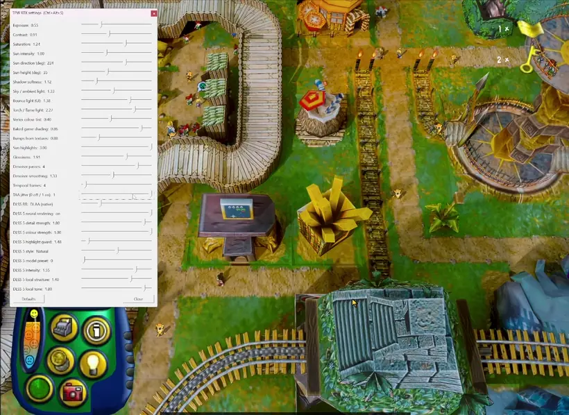
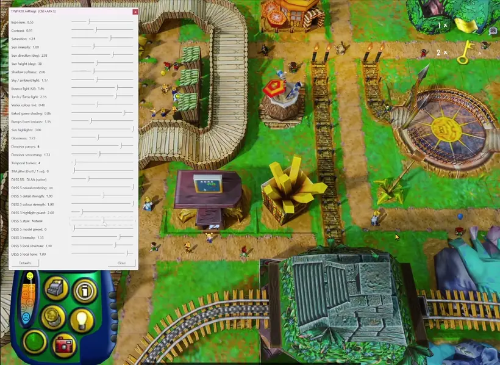
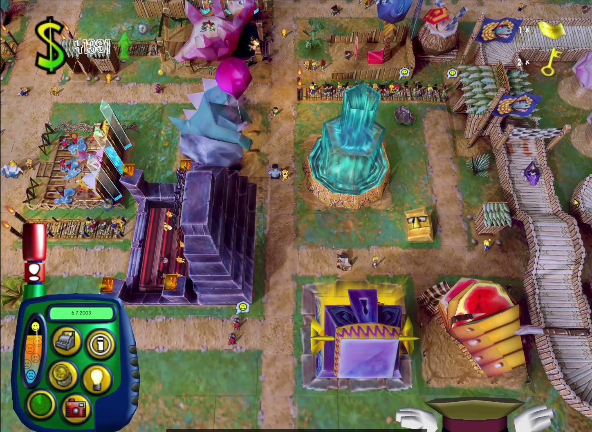
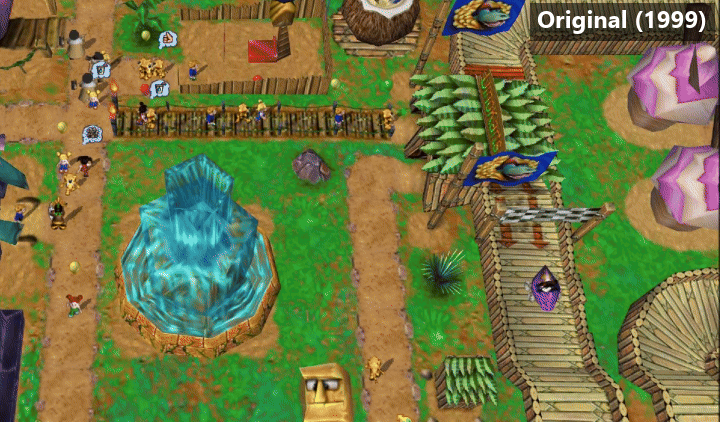
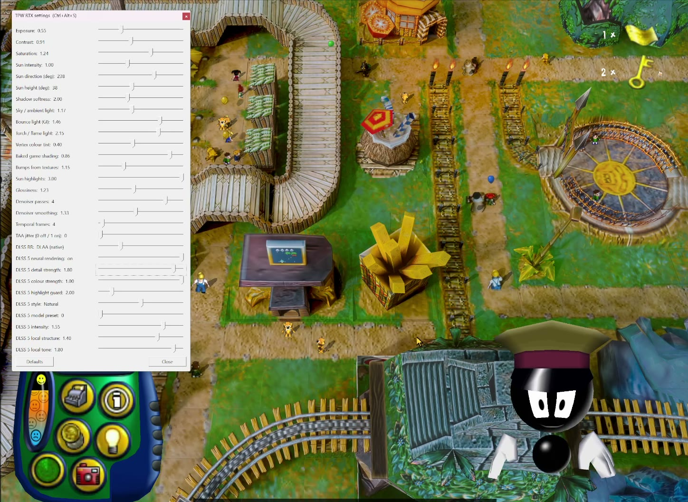

# tpw-rtx: path-traced SimTheme Park

**Real-time ray-traced lighting, NVIDIA DLSS Ray Reconstruction and (optionally) DLSS 5 for _SimTheme Park_ / _Theme Park World_ (Bullfrog, 1999).**

<p align="center">
  
</p>

<p align="center">
  <b><a href="https://github.com/flamacore/tpw-rtx/releases/latest">⬇ Download the latest release</a></b>
</p>

The game still runs its own 1999 engine: the simulation, the visitors, the UI, everything. tpw-rtx watches what it draws, rebuilds the
3D scene every frame, and renders it again with a modern path tracer on your RTX card. The result is shown on top of the game window.
The game never knows.

- ☀️ **Path-traced lighting:** a sun with soft shadows, one bounce of global illumination, sky light, and torches and flames that cast light.
- 🧠 **NVIDIA DLSS Ray Reconstruction:** AI denoising and anti-aliasing, at native resolution (DLAA) or upscaled.
- ✨ **DLSS 5 neural rendering:** _optional, unofficial and experimental._ See [docs/DLSS5.md](docs/DLSS5.md).
- 🎚️ **Live settings panel (Ctrl+Alt+S):** sun direction and height, exposure, colour, bounce light, bumps, highlights and DLSS. The game keeps running while you tune.
- 🪨 **Pseudo-PBR:** surface bumps and glossy sun highlights derived from the original textures.
- 🎥 **Camera upgrades:** zoom much further in and out, an FOV slider, WASD to pan and Q/E to rotate, and _experimental_ true
  widescreen (the game renders a wider view instead of stretching).
- 🛠️ **Fixes that help even without ray tracing:**
  - the park slowing to a crawl when Windows has been running for a few days;
  - the mouse freezing after alt-tab;
  - the "out of video memory" fall-back to software rendering on modern systems;
  - a correct 4:3 window.

| Live tuning with the settings panel | A finished park |
|:---:|:---:|
|  |  |

### Before & after

<p align="center">
  
  <br><sub>Same park, same camera: the original 1999 renderer versus tpw-rtx's path tracing with DLSS Ray Reconstruction and DLSS 5 (optional and unofficial, see <a href="docs/DLSS5.md">docs/DLSS5.md</a>).</sub>
</p>

---

## Requirements

| | |
|---|---|
| **Game** | _SimTheme Park_ for Windows. You need your own copy. The ray tracing is tied to one specific `TP.EXE` build (see below). |
| **GPU** | NVIDIA GeForce RTX (DXR 1.1). An RTX 20 series card or newer for DLSS Ray Reconstruction. The author plays on an RTX 4080 SUPER. |
| **Driver** | A recent NVIDIA driver. DLSS Ray Reconstruction needs 580 or newer. |
| **OS** | Windows 10 or 11, 64-bit. |

**Which `TP.EXE`?** Every game address the hook reads was found in one build, SHA-256
`d0399acfc1bcbdcbe5836814b19e386486bfa06f057646ae7821bc25e9927ac9`. Check yours in PowerShell:

```powershell
Get-FileHash "C:\Path\To\SimTheme Park\TP.EXE"
```

Other builds (Theme Park World, other languages or patches) still get the speed, video-memory and alt-tab fixes, but no ray tracing.
The hook detects this and stays in safe mode.

## Installation

1. **Copy the game out of `Program Files`.** Copy the whole folder, for example from `C:\Program Files (x86)\SimTheme Park` to
   `C:\Games\SimTheme Park`. Windows blocks writes under Program Files, and the original install stays untouched as a backup.
2. **Download tpw-rtx.** Get `tpw-rtx.zip` from the [latest release](https://github.com/flamacore/tpw-rtx/releases/latest),
   extract it anywhere, and run `install.bat`. Point it at your game folder; it backs up anything it replaces.
   You can also copy the files next to `TP.EXE` by hand.
3. **Download dxwrapper** (DirectDraw → Direct3D 9, windowed). Get `dxwrapper.zip` from
   [dxwrapper v1.4.7900.25](https://github.com/elishacloud/dxwrapper/releases/tag/v1.4.7900.25), the tested version. Copy
   `dxwrapper.dll` and `Stub\ddraw.dll` into the game folder. Keep the `dxwrapper.ini` from tpw-rtx; it has the settings this game needs.
4. **Download DLSS Ray Reconstruction.** This is recommended, and it's NVIDIA's file, so you download it from NVIDIA: put
   [`nvngx_dlssd.dll`](https://github.com/NVIDIA/DLSS/raw/v310.9.16/lib/Windows_x86_64/rel/nvngx_dlssd.dll) (from the
   [NVIDIA DLSS SDK](https://github.com/NVIDIA/DLSS)) into the game folder. Without it, tpw-rtx uses its own, simpler denoiser.
5. **DLSS 5 (optional, unofficial).** Read [docs/DLSS5.md](docs/DLSS5.md) first.
6. **Play.** Start `TP.EXE`. If it closes straight away, right-click it and choose **Run as administrator**. Open a park and the
   ray-traced view takes over. Press **Ctrl+Alt+R** to flip between the original picture and the ray-traced one.

Your game folder should end up containing:

```
TP.EXE                          (the game)
dinput.dll                      tpw-rtx hook
tpwrtx_viewer.exe, rt.cso       tpw-rtx renderer
tpwrtx_nvngx.dll_forwarder.dll  tpw-rtx, only used for DLSS 5
tpwrtx.ini, dxwrapper.ini       settings
ddraw.dll, dxwrapper.dll        from dxwrapper
nvngx_dlssd.dll                 from NVIDIA (optional, recommended)
nvngx_dlssnr.dll                DLSS 5 model, you supply it (optional, unofficial)
```

**If the game falls back to software rendering**, the picture looks flat and pixelated and there's no ray tracing. Delete
`save\Config.tcf` in the game folder. The game then detects Direct3D again on the next start.

## Controls

| Keys | What it does |
|---|---|
| **W A S D** | Pan the camera (the arrow keys and numpad still work) |
| **Q / E** | Rotate the camera |
| **Ctrl+Alt+S** | Settings panel. The game keeps running; the mouse goes to the panel until you close it. |
| **Ctrl+Alt+R** | Show/hide the ray-traced picture (compare with the original) |
| **Ctrl+Alt+T** | Ray tracing on/off (off shows the original game) |
| **Ctrl+Alt+C** | Free orbit camera on/off (fun for screenshots; the game is still controlled normally) |
| **Ctrl+Alt+O** | Auto-orbit camera |



Settings save automatically to `tpwrtx_settings.json` in the game folder. **Defaults** resets everything.

| Group | Settings |
|---|---|
| Picture | exposure, contrast, saturation |
| Sun & sky | sun intensity, direction, height, shadow softness, sky/ambient light, bounce light (GI), torch/flame light |
| Materials | vertex colour tint, baked game shading, bumps from textures, sun highlights, glossiness |
| Own denoiser | passes, smoothing, temporal frames, TAA jitter (only used when DLSS Ray Reconstruction is off) |
| DLSS | Ray Reconstruction: off / DLAA / Quality / Balanced / Performance |
| DLSS 5 | on/off, detail strength, colour strength, highlight guard, style, model preset, intensity, local structure, local tone, resolution |
| Camera | FOV (90 = original), closest zoom (70 = original), farthest zoom (130 = original), WASD pan + Q/E rotate on/off |

**Camera notes:** the game tilts the camera with the zoom, so zooming in also lowers the view and zooming far out turns it almost
top-down. While WASD is on, the game's own one-letter shortcuts **A** (all items) and **S** (all staff) are switched off; their
toolbar buttons still work.

**Widescreen (experimental):** add `resolution = auto` (your monitor's resolution) or a size such as `resolution = 2560x1440` to
`tpwrtx.ini`. The game then renders at that size with a wider field of view, and mouse picking is adjusted to match. The game's
interface was made for 4:3 and isn't laid out for other shapes, so expect some oddities there. Remove the line to go back.

**Performance:** the renderer draws at the game window's height (`height = auto` in `tpwrtx.ini`). The two DLSS passes are by far
the most expensive part. On an RTX 4080 SUPER at 3640×2048:

| Setting | GPU time per frame |
|---|---|
| DLSS Ray Reconstruction, DLAA | 12 ms |
| DLSS Ray Reconstruction, **Quality** | 5.5 ms |
| DLSS 5 at 100% resolution | 17 ms |
| DLSS 5 at **67%** resolution (default) | 8.6 ms |

So for smooth camera movement with everything on, use DLSS RR **Quality** and leave DLSS 5 at **67%**. That comes to about
16 ms per frame, or 60 fps, at that size. If it's still too slow, try DLSS **Performance** or a lower fixed `height`, such as
`1440`. Every 5 seconds `tpwrtx_viewer.log` records a `perf:` line with the frame rate and what each stage costs.

## Troubleshooting

| Problem | Try |
|---|---|
| Game closes immediately | Run `TP.EXE` as administrator. |
| No ray tracing, original graphics only | Make sure you're in a park; menus are never ray traced. Check that `tpwrtx_viewer.exe` and `rt.cso` are in the folder. Read `tphook.log` and `tpwrtx_viewer.log`. |
| "not the supported build" in `tphook.log` | Your `TP.EXE` differs (see Requirements). |
| Flat, pixelated picture | The game is in software mode: delete `save\Config.tcf`. |
| Stretched picture | The hook keeps the window at 4:3; give it a second after start-up. |
| DLSS rows do nothing | Check that `nvngx_dlssd.dll` is in the game folder. `tpwrtx_viewer.log` says "DLSS Ray Reconstruction: available". |
| Choppy when the camera moves | Read the `perf:` lines in `tpwrtx_viewer.log`. If the renderer's fps is below the game's, see **Performance** above. |
| The game crashed | `tphook.log` has a `[crash]` report and the game folder has `tphook_crash.dmp`. Please attach both to a [GitHub issue](https://github.com/flamacore/tpw-rtx/issues). |

**Uninstall:** delete the tpw-rtx files listed above, plus `ddraw.dll` and `dxwrapper.dll`, and restore anything from the
`tpw-rtx-backup` folder. The original install in Program Files was never touched.

## Known limitations

- Windowed mode only, by design: running the game windowed through dxwrapper is what makes the modern fixes possible.
- Some 3D UI pop-ups and very fast camera moves can show small glitches. Only the camera has motion vectors, so moving visitors can
  smear slightly under DLSS.
- The game reconstructs only what it draws; things far off-screen are kept from earlier frames and can be out of date.
- One `TP.EXE` build only, for the ray tracing and the camera upgrades (see Requirements).
- Widescreen is experimental: parts of the game's 4:3 interface may sit oddly.
- Zoomed very far out, the game draws much more of the park, which costs CPU time in the 1999 engine.

## How it works

A 32-bit `dinput.dll` proxy loads into the game. It hooks DirectDraw and Direct3D, captures every triangle and texture the game
draws, and fixes a few old bugs along the way. Every frame goes through shared memory to a 64-bit Direct3D 12 renderer. That
renderer rebuilds the scene in world space using the game's camera, path-traces it with DXR inline ray queries, runs DLSS, and
hands the image back. The hook then shows it on the game window through DirectComposition.

More detail is in [docs/HOW_IT_WORKS.md](docs/HOW_IT_WORKS.md). To build it yourself, see [docs/BUILDING.md](docs/BUILDING.md).

## Credits & legal

- Made by [flamacore](https://github.com/flamacore).
- [dxwrapper](https://github.com/elishacloud/dxwrapper) by Elisha Riedlinger (zlib licence). Downloaded separately; the
  `dxwrapper.ini` here is a modified copy of its sample file.
- [NVIDIA DLSS SDK](https://github.com/NVIDIA/DLSS). The prebuilt renderer contains NVIDIA NGX SDK object code under the
  [NVIDIA RTX SDKs licence](https://github.com/NVIDIA/DLSS/blob/main/LICENSE.txt). NVIDIA's DLLs are not included in this repository
  or its releases.
- The DLSS 5 approach was learned from the [OptiScaler DLSS-NR module](https://github.com/optiscaler/OptiScaler/pull/1116); the
  code here is independent.
- [Ghidra](https://ghidra-sre.org/) was used to understand the game's executable.

This project is not affiliated with or endorsed by Electronic Arts, Bullfrog Productions or NVIDIA. _SimTheme Park_, _Theme Park
World_, NVIDIA, RTX and DLSS are trademarks of their respective owners. You need your own copy of the game; no game files are
distributed here.

The source code in this repository is under the [MIT licence](LICENSE). Third-party notices are in
[THIRD_PARTY_NOTICES.md](THIRD_PARTY_NOTICES.md).
