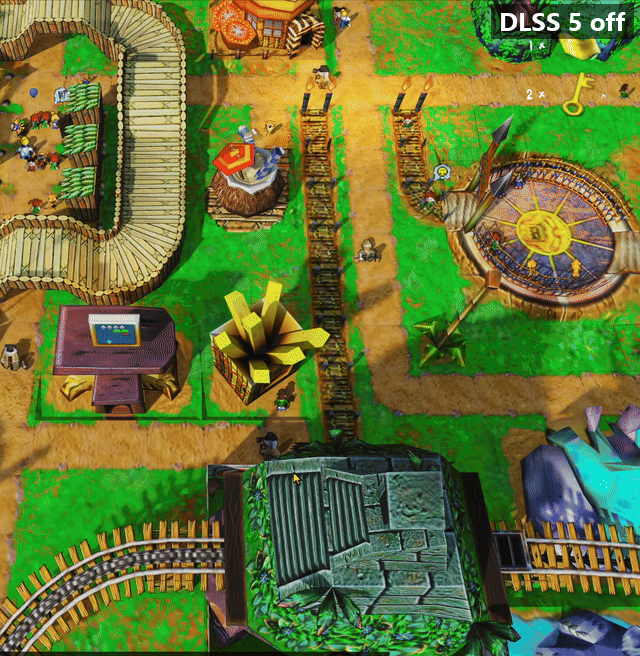

# DLSS 5 neural rendering (optional, unofficial, experimental)

> **Read this before you use it.** NVIDIA has not published a public SDK for DLSS 5. This part of tpw-rtx drives NVIDIA's model in an
> undocumented way and works around a check in that model about who is allowed to call it. It is **not supported by NVIDIA**. It
> **may conflict with NVIDIA's licence terms**, and any driver or model update can break it. Use it at your own risk. Everything
> else in tpw-rtx works without it, and you can delete `tpwrtx_nvngx.dll_forwarder.dll` if you don't want it at all.

## What it does

DLSS 5 ("3D-guided neural rendering") is a generative pass. It looks at a finished frame plus depth and motion vectors and
re-synthesises lighting and material detail. In tpw-rtx it runs on the final, colour-graded, ray-traced image, before water, smoke
and the game's UI are drawn on top, so it never touches the interface. Its picture is then blended back with three settings:

- **Detail strength:** how far to move towards the model's picture. 0 = off, 1 = the model's picture, above 1 = exaggerated.
- **Colour strength:** 0 keeps the game's colours and takes only the model's brightness; 1 takes its colours too.
- **Highlight guard:** caps how much brighter any pixel may get, so lights don't blow out.

**Style** (Default / Natural / Cinematic), **model preset**, **intensity**, **local structure** and **local tone** are the model's
own parameters. Changing one rebuilds the model, with a short pause.

## What you need

- **An NVIDIA RTX 50 series GPU.** That is what NVIDIA officially supports for DLSS 5. Reports of it running on older cards rely on
  modified files, which this project does not provide or link to.
- **`nvngx_dlssnr.dll`, the DLSS 5 model.** NVIDIA does not offer it for download, and it can't be included here. Games with official
  DLSS 5 support ship it in their install folders (for example NBA 2K27 and Hogwarts Legacy, as of November 2026). If you own one of
  them, copy `nvngx_dlssnr.dll` from that game's folder into your SimTheme Park folder. **Don't download it from random websites:**
  it is a 165 MB executable, and you can't verify a stranger's copy.
  - In Windows Explorer, right-click the DLL, open Properties → Digital Signatures, and check that it is signed by NVIDIA
    Corporation.
  - In its file details, the description should read "NVIDIA DLSSNR". A file of that size named anything else is the wrong file.
- **`tpwrtx_nvngx.dll_forwarder.dll`**, from the tpw-rtx release.

Then start the game, open a park, and look for the **DLSS 5** rows in the settings panel (Ctrl+Alt+S). It is on by default whenever
the model file is present.

## Why the odd file name

The model checks which file is calling it and refuses any caller whose path does not contain `nvngx.dll`; normally only NVIDIA's own
driver component calls it. `tpwrtx_nvngx.dll_forwarder.dll` is a few lines of code
([src/dlss5/nr_forwarder.c](../src/dlss5/nr_forwarder.c)) that make the calls on the renderer's behalf. That is the "workaround" the
warning above refers to.

## If it doesn't work

`tpwrtx_viewer.log` in the game folder records each step:

| Log line | Meaning |
|---|---|
| `DLSS 5: off (nvngx_dlssnr.dll is not in the game folder)` | The model file is missing. |
| `DLSS 5: model init FAILED` | Usually an unsupported GPU or driver. |
| `DLSS 5: model created at …` | Running. |
| `DLSS 5: evaluate failed (…)` | It loaded but refuses frames. Turn it off in the panel. |

If a driver or model update breaks it, switch **DLSS 5 neural rendering** off in the panel or delete `nvngx_dlssnr.dll`.

## Credits

The parameter names, the feature number and the caller check were worked out by the community, in particular the
[OptiScaler DLSS-NR module](https://github.com/optiscaler/OptiScaler/pull/1116), which in turn credits
[RenoDX](https://github.com/clshortfuse/renodx) for its colour composition. tpw-rtx's implementation is written independently.
